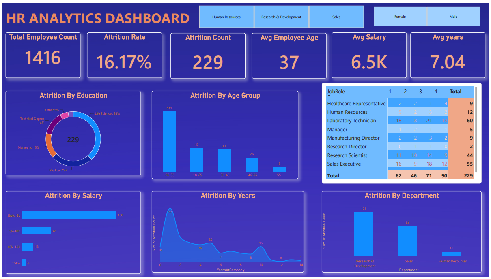

# HR Analytics Dashboard | Power BI

## Project Overview

This project focuses on analyzing employee data using Microsoft Power BI to understand workforce demographics, employee attrition, salary distribution, job roles, and department-wise trends.

The objective is to identify employee attrition patterns and provide insights into workforce composition.

## Dashboard Preview

## Key Performance Indicators (KPIs)

| Metric | Result |
|---|---:|
| Total Employees | 1,416 |
| Attrition Rate | 16.17% |
| Attrition Count | 229 |
| Average Employee Age | 37 |
| Average Salary | 6.5K |
| Average Years | 7.04 |

## Key Analysis

**1. Employee Attrition Analysis**
- Analyzed overall employee attrition.
- Evaluated attrition rate and attrition count.

**2. Workforce Demographics**
- Analyzed employee distribution by age groups.
- Examined attrition by education.
- Included gender-based filtering.

**3. Salary Analysis**
- Analyzed employee attrition across different salary ranges.
- Compared attrition across salary categories.

**4. Department-wise Attrition**
- Research & Development: 121
- Sales: 83
- Human Resources: 11

**5. Job Role Analysis**
- Examined attrition across different job roles.
- Compared employee attrition across job roles and experience levels.

**6. Years at Company Analysis**
- Analyzed attrition based on employees' years at the company.

## Tools & Technologies
- Microsoft Power BI
- HR Analytics Dataset (CSV)

## Project Files

| File | Description |
|---|---|
| 6.1_HR_ANALYTICS_DASHBOARD.pbix | Power BI dashboard |
| 6.1_HR_ANALYTICS_DASHBOARD.pdf | Dashboard report |
| HR_Analytics.csv | HR employee dataset |

## Key Insights

- The dataset contains 1,416 employees.
- A total of 229 employees have left, representing an attrition rate of 16.17%.
- Research & Development has the highest attrition count among the three departments.
- The average employee age is 37 years.
- The dashboard provides multiple views of employee attrition based on salary, education, age, department, and job role.

## Conclusion

This project demonstrates the use of Power BI for HR analytics and employee attrition analysis. The dashboard helps visualize workforce patterns and provides insights that can support data-driven HR decision-making.

---

**Project Category:** Data Analytics | Human Resources Analytics

**Created Using:** Microsoft Power BI
